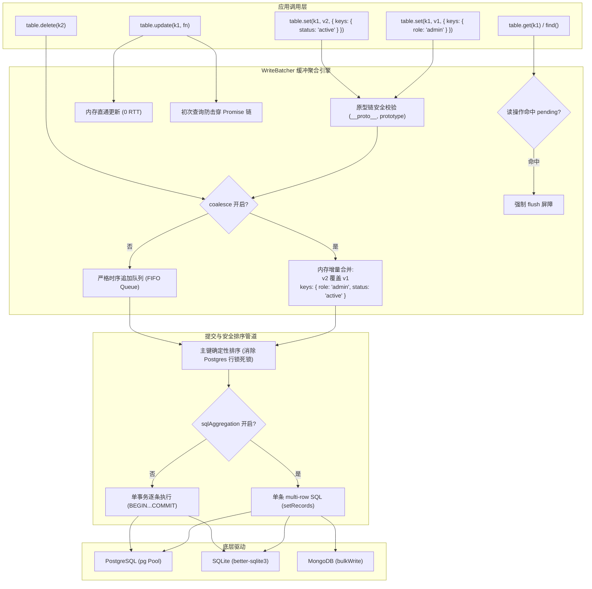

# TASK-029-AUTO-BATCH: 高性能微批处理与写聚合子系统 (Auto Batch & Write Coalescing)

> **任务定位**: 在 Node.js 服务端架构下，构建面向高吞吐写场景的微批处理与写聚合引擎（`WriteBatcher`），全量支持 Multi-Key 物理二级索引表、两层聚合（内存折叠 vs 严格保序、SQL multi-row 聚合 vs 单事务逐条）、同 Key 并发原子化处理（防击穿与内存直通）、以及 PostgreSQL / SQLite / MongoDB 生产环境安全加固（防死锁排序、ANSI 转义、原型链污染防御、优雅停机）。

---

## 1. 目标与规格范围

1. **统一微批聚合引擎 (`WriteBatcher<V>`)**:
   - 时间窗口防抖（`maxWaitMs`，默认 20ms）与容量阈值（`maxBatchSize`，默认 50 条）。
   - Node.js 异步定时器安全管理：使用 `timer.unref()` 避免阻塞进程自然退出；
   - 内存容量保护（Bounded Buffer Backpressure）：当未排空条目超过阈值（如 `maxBatchSize * 10`）时，施加同步背压或强制立刻 flush，杜绝突发洪峰打爆 Node.js 堆内存。
   - 读己之写一致性（RYW / Read-Your-Own-Writes）：读取前透明排空或内存直通，确保读路径 100% 具备因果一致性。
   - 零异常吞没（Zero Error Swallowing）：批次提交失败时，精准将底层错误分发传播给该批次内的每一个 Promise 调用方。

2. **Multi-Key 物理表深度适配**:
   - 兼容支持标准 KV 表与物理 Schema 表（`TableSchema` / `MultiKeySchema`）。
   - 批处理项支持 `keys`（物理二级索引列）。
   - 内存折叠时对 `keys` 执行浅层增量合并（Incremental Shallow Merge），安全保留多字段索引，同时阻断原型链污染（`__proto__`, `constructor`, `prototype`）。

3. **两层聚合正交可配置 (`coalesce` & `sqlAggregation`)**:
   - `coalesce: boolean`（默认 `true`）：控制是否在内存层折叠相同 Key（`set` 覆盖与 `set`+`delete` 抵消）。设为 `false` 则严格按调用时序保序攒批（满足 CDC、Trigger 与审计日志需求）。
   - `sqlAggregation: boolean`（默认 `true`）：控制下发给数据库时是拼装为单条 multi-row SQL（最高性能），还是在单事务内循环执行独立 Prepared Statements（细粒度交替）。

4. **同 Key 并发冲突治理与数据一致性**:
   - 并发 `update` 防击穿与在途去重队列（In-Flight Deduplication & Chain Serialization），彻底杜绝并发更新导致丢失更新（Lost Update）。
   - 内存直通更新（In-Memory Fast-Path）：已处于缓冲中的 Key 直接在内存中完成增量读-改-写，实现 0 次数据库读 RTT。
   - `set` 与 `delete` 抵消时 Promise 状态精准流转，杜绝任务悬挂。

5. **PostgreSQL / SQLite 生产安全加固**:
   - **PostgreSQL 交叉行锁死锁杜绝（Deadlock Prevention）**：在下发 multi-row `INSERT ... ON CONFLICT DO UPDATE` 前，必须对待落盘的 Key 进行严格的确定性字典序/数值序排序，保证行锁获取顺序一致。
   - **优雅停机与进程退出守卫**：`kvdb.close()` 自动排空所有关联 Table 的批处理队列，保障在服务下线或重启时不丢内存数据。

---

## 2. 架构设计与数据流

---

## 3. 验收标准与验证方案

1. **契约与选项**:
   - `KVDBOptions` 与 `TableOptions` 正确识别 `autoBatch: boolean | AutoBatchOptions`。
   - 正确提供 `table.flush()` 与 `table.pendingBatchCount`。
2. **Multi-Key 行为**:
   - 同 Key 多次写入携带不同二级索引字段，合并且落盘后所有二级字段均正确存储，且可通过 `find` 查询到。
   - 过滤非法原型键，防止原型链污染。
3. **聚合与非聚合模式**:
   - `coalesce: true` 下，同一微批内对同一 Key 的 10 次写入最终只产生 1 次底层写操作，写+删完全抵消。
   - `coalesce: false` 下，同一微批内 10 次写入全部送往底层执行，顺序完全保序。
   - `sqlAggregation: false` 下，底层驱动能够以单事务逐条执行。
4. **并发与一致性**:
   - 10 个并发 `table.update` 针对同一计数器，最终数值准确递增 10 次（0 丢失更新）。
   - 写入后立即 `table.get()` 能 100% 读到最新值（RYW 保障）。
5. **PostgreSQL 死锁防御与健壮性**:
   - 无论调用顺序如何杂乱，送往数据库的多行 UPSERT 主键均按字典序严格排序。
   - 批次发生底层异常时，所有调用方的 Promise 均精准收到异常（零吞没）。
   - `kvdb.close()` 自动安全排空。
6. **全量测试套件**:
   - 新增 `test/unit/auto-batch.test.ts`，涵盖全部上述规格。
   - `pnpm test` 全部绿灯，`pnpm typecheck` 0 错误，`pnpm build` 成功。
